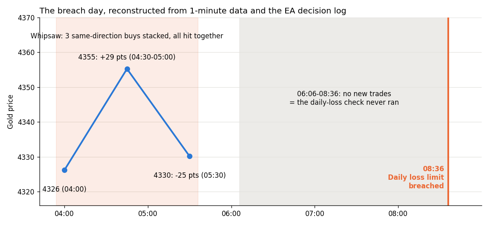
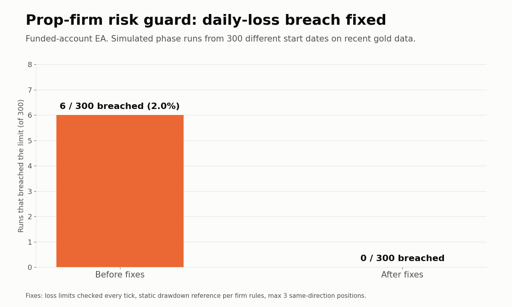

# Prop-firm risk guard: case study

**How a funded-account EA breached its daily loss limit, why it happened, and the three fixes that took breaches from 6 to 0 in 300 simulated runs.**

This repository is a write-up of real debugging work, with short code excerpts. The full risk guard EA is a paid product; see the bottom of this page.

## What happened

An MT5 Expert Advisor trading gold on a prop-firm challenge account ($5,000, 5% daily loss limit, 10% max drawdown) breached the daily loss limit at 08:36. Trading was disabled.

## Root cause, confirmed from the source code and decision log

**1. The daily-loss check only ran before NEW trades.** It lived inside the lot-sizing function. Between 06:06 and 08:36 the EA attempted no new entries, so the check never executed while open positions kept losing. ([excerpt](excerpts/01_bug_check_only_on_new_trades.mq5))

**2. A fast whipsaw hit stacked positions.** Gold fell to 4326, spiked about 29 points to 4355, and dropped about 25 points to 4330 within roughly 90 minutes. Three buy positions opened in the same minute moved together. Swings of this size (25+ points with a 20+ point reversal inside an hour) occurred about 0.76 times per day in the 2026 data: not rare.

**3. Secondary issue:** the EA's own realized-P/L tracker sometimes under-counted losses compared with the broker's reported profit, so it believed it had more room than it did.

## The three fixes

| Fix | What changed | Excerpt |
|---|---|---|
| 1. Check every tick | Daily loss and max drawdown are evaluated on every tick, independent of entries; on breach the EA flattens and locks until the firm's reset time | [02](excerpts/02_fix_check_every_tick.mq5) |
| 2. Correct drawdown reference | The firm's max drawdown is **static** (from the starting balance), not trailing from the equity peak. The code now matches the rule | [03](excerpts/03_fix_static_drawdown_and_direction_cap.mq5) |
| 3. Same-direction cap | At most 3 open positions in the same direction. Opposite-direction overlaps (about 17% of recent trade attempts) stay allowed, so valid trades aren't blocked | [03](excerpts/03_fix_static_drawdown_and_direction_cap.mq5) |

## Validation

The setup logic was rebuilt exactly from the EA source and replayed on recent 1-minute gold data, from **300 different start dates**.

| Configuration | Runs that breached | Median days to pass phase |
|---|---|---|
| Before fixes | **6 / 300 (2.0%)** | |
| All three fixes, cap = 3 | **0 / 300** | 3.8 |
| Cap = 2 (more restrictive) | 0 / 300 | 5.7 (slower, no extra safety) |
| Soft cap (smaller size past 3) | 3 / 300 | (rejected) |

A hard cap of 3 was both the safest and the fastest option tested. The worst drawdown with all fixes was 9.6%, close to the 10% line, so the margin is real but not generous.

## Lessons for any prop-firm EA

1. **Risk checks must run every tick**, never only inside entry or sizing code.
2. **Count equity, not just closed trades.** Open losses are what breach accounts.
3. **Read the firm's exact rules**: static vs trailing drawdown, reset time, equity vs balance. A correct check against the wrong reference is still a bug.
4. **Cap same-direction exposure.** Correlated positions turn one bad move into a breach.
5. **Validate across hundreds of start dates**, not one backtest.

## Want this for your account?

I build a configurable risk guard for MT4/MT5: equity-based daily loss lock with a safety buffer, static or trailing drawdown, same-direction and lot caps, on-chart panel and alerts, set to your firm's exact rules or built into your own EA.

Built by **Sahil T.**, trading software developer. Contact me via Upwork or Fiverr.

*Software and testing only. A risk tool reduces breaches but cannot guarantee that a challenge is passed. Not financial advice.*

**License:** All rights reserved. Published for viewing only; see [LICENSE](LICENSE).
